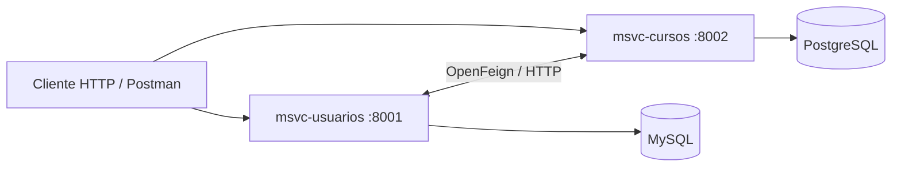

# Integración de usuarios y cursos

Proyecto académico de backend con dos servicios independientes para gestionar usuarios, cursos y su relación. Desarrollado por Renzo Paull Castañeda como práctica de APIs REST, persistencia y comunicación entre servicios.

## Arquitectura



| Módulo | Responsabilidad | Persistencia |
| --- | --- | --- |
| `msvc-usuarios` | CRUD de usuarios, validación de campos y correo único | MySQL |
| `msvc-cursos` | CRUD de cursos y asociación de usuarios | PostgreSQL |

**Tecnologías:** Java 25, Spring Boot 3.5.9, Spring Cloud 2025.0.1, OpenFeign, Spring Data JPA, Bean Validation, Lombok y Maven.

## Ejecución local

Requisitos: JDK 25, Maven, MySQL y PostgreSQL. Los clientes Feign apuntan a `localhost`; esta guía corresponde a ejecución local, no a contenedores.

1. Clonar el repositorio:

```sh
git clone https://github.com/Paull-Cas/curso-integracion.git
cd curso-integracion
```

2. Crear las bases `msvc_usuarios` en MySQL y `msvc_cursos` en PostgreSQL. Otorgar a los usuarios de desarrollo permisos sobre sus respectivas bases. Hibernate utiliza `ddl-auto: update` para generar o actualizar las tablas.

3. Configurar las variables de entorno en el IDE o en las terminales de ejecución:

| Variable | Uso |
| --- | --- |
| `USUARIOS_DB_USER` | Usuario de MySQL |
| `USUARIOS_DB_PASSWORD` | Contraseña de MySQL |
| `USUARIOS_DB_URL` | Opcional; predeterminado `jdbc:mysql://localhost:3306/msvc_usuarios?createDatabaseIfNotExist=true` |
| `CURSOS_DB_USER` | Usuario de PostgreSQL |
| `CURSOS_DB_PASSWORD` | Contraseña de PostgreSQL |
| `CURSOS_DB_URL` | Opcional; predeterminado `jdbc:postgresql://localhost:5432/msvc_cursos` |

No guardar contraseñas en el repositorio. Usar únicamente datos ficticios para las pruebas.

4. Desde la raíz, compilar ambos módulos:

```sh
mvn clean package -DskipTests
```

5. Iniciar los servicios en dos terminales, con las variables configuradas en cada una:

```sh
mvn -pl msvc-usuarios spring-boot:run
```

```sh
mvn -pl msvc-cursos spring-boot:run
```

Ambos servicios deben estar activos para las operaciones que se comunican entre sí.

## APIs principales

| Método | Ruta | Función |
| --- | --- | --- |
| GET / POST | `http://localhost:8001/api/usuarios` | Listar / crear usuarios |
| GET / PUT / DELETE | `http://localhost:8001/api/usuarios/{id}` | Consultar / editar / eliminar usuario |
| GET | `http://localhost:8001/api/usuarios/usuarios-por-curso?ids=1,2` | Consultar usuarios por sus identificadores |
| GET | `http://localhost:8002/api/curso` | Listar cursos |
| POST | `http://localhost:8002/api/curso/` | Crear curso |
| GET / PUT / DELETE | `http://localhost:8002/api/curso/{id}` | Consultar / editar / eliminar curso |
| PUT | `http://localhost:8002/api/curso/asignar-usuario/{cursoId}` | Asociar un usuario existente |
| POST | `http://localhost:8002/api/curso/crear-usuario/{cursoId}` | Crear y asociar un usuario |
| DELETE | `http://localhost:8002/api/curso/eliminar-usuario/{cursoId}` | Retirar la asociación de un usuario |

Ejemplo de creación de un curso:

```http
POST http://localhost:8002/api/curso/
Content-Type: application/json

{"nombre":"Integración de sistemas"}
```

## Alcance y mejoras pendientes

Es un ejercicio académico, no un servicio preparado para producción. El modelo de usuario incluye un campo `password` sin un flujo de autenticación seguro; no usar contraseñas reales. Antes de un uso real deben incorporarse DTOs, protección de credenciales de usuarios, autenticación y autorización, pruebas de integración y gestión de errores entre servicios.

Los tests de contexto requieren las bases de datos y las variables de conexión; `-DskipTests` compila el proyecto, pero no certifica su funcionamiento.

## Autor

[Renzo Paull Castañeda](https://github.com/Paull-Cas) · [Otros proyectos](https://github.com/Paull-Cas/proyectos)
